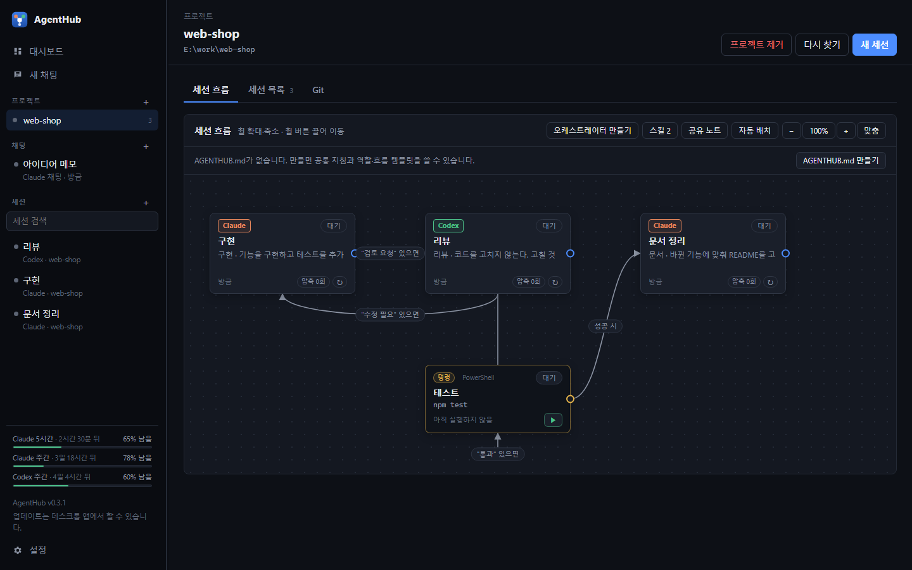
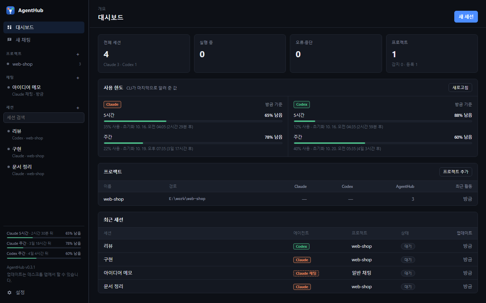
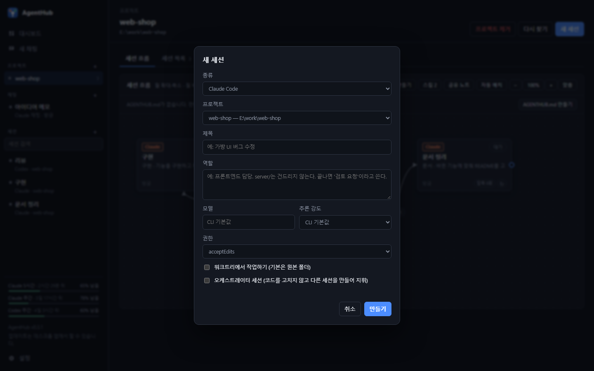
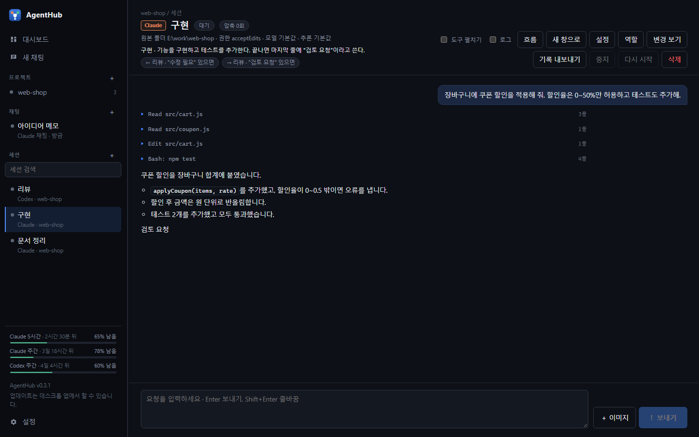
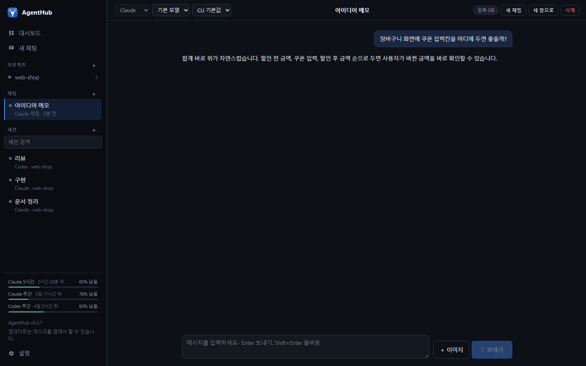
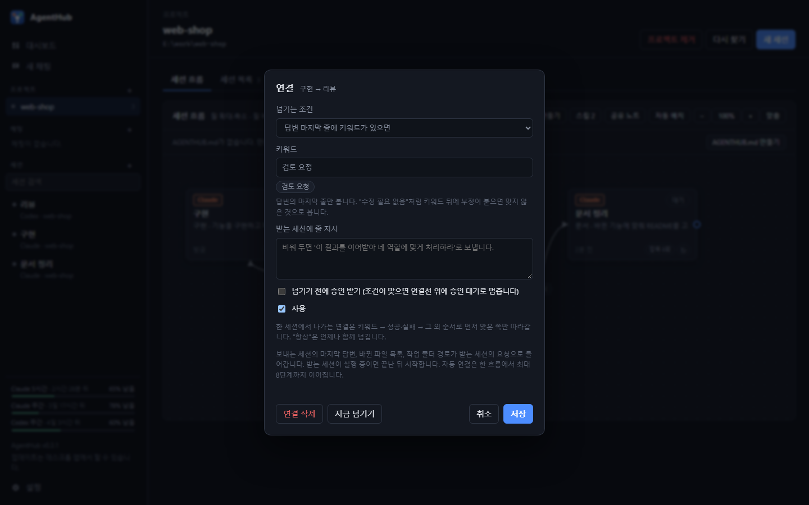
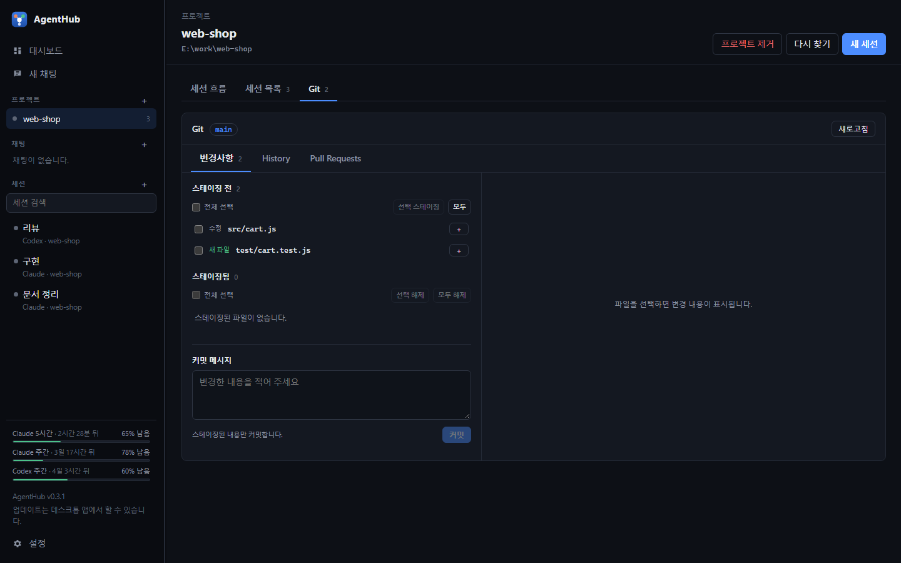
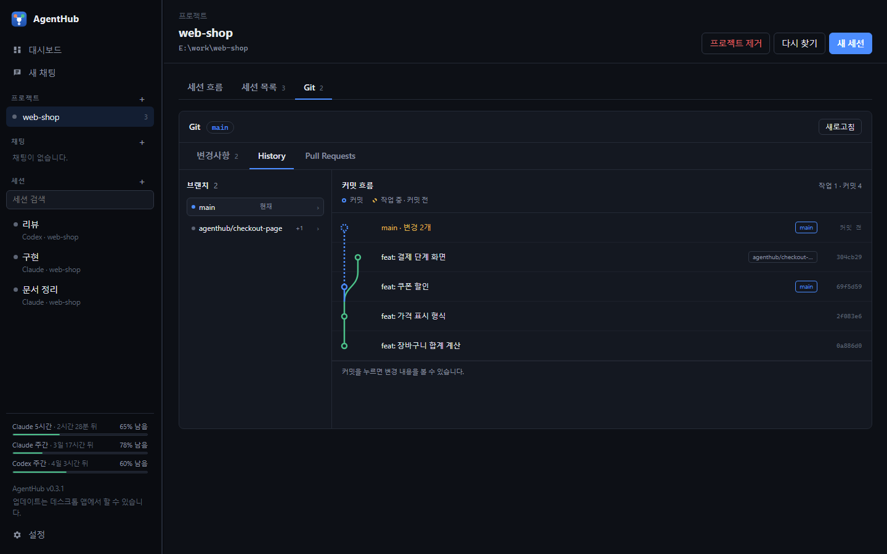

# AgentHub

Claude Code와 Codex 세션을 한 화면에서 만들고 이어 가는 Windows 데스크톱 앱이다. 여러 AI 세션에 일을 나눠 맡기고, 한 세션의 결과를 다음 세션으로 자동으로 넘길 수 있다.

각 AI의 CLI를 대신 실행하므로 이미 로그인한 구독 계정의 사용량 안에서 동작한다. API 키는 쓰지 않는다.



- **여러 세션을 한곳에서**: Claude Code·Codex 세션을 프로젝트별로 모아 보고 이어서 대화한다.
- **세션 흐름**: "구현 → 리뷰 → 테스트"처럼 세션을 연결선으로 이어, 결과가 조건에 맞으면 다음 세션으로 넘긴다.
- **세션끼리 소통**: 연결된 세션끼리 필요할 때 서로 묻고 답한다.
- **Git 화면**: 바뀐 파일 확인, 스테이징, 커밋, 브랜치 병합, Pull Request까지 앱 안에서 한다.
- **사용 한도 확인**: Claude·Codex 구독의 남은 사용량을 늘 보여 준다.

개발자용 안내(소스 실행, 빌드, 릴리스, 내부 구조)는 [docs/development.md](docs/development.md)에 있다.

## 목차

- [설치](#설치)
- [처음 시작하기](#처음-시작하기)
- [세션 만들고 대화하기](#세션-만들고-대화하기)
- [일반 채팅](#일반-채팅)
- [세션 흐름으로 일 나누기](#세션-흐름으로-일-나누기)
- [세션끼리 소통](#세션끼리-소통)
- [스킬](#스킬)
- [Git 탭](#git-탭)
- [기존 Claude Code·Codex 세션 가져오기](#기존-claude-codecodex-세션-가져오기)
- [사용 한도](#사용-한도)
- [권한 모드](#권한-모드)
- [업데이트](#업데이트)
- [알려진 한계](#알려진-한계)

## 설치

[Releases](https://github.com/Lyeol2/AgentHub/releases)에서 내려받는다.

- `AgentHub-Setup-<버전>.exe`: 설치형. 자동 업데이트를 받는다.
- `AgentHub-<버전>-portable.exe`: 설치 없이 실행한다.

필요한 것은 다음과 같다.

- git
- Claude Code CLI 또는 Codex CLI 중 쓰려는 것. 로그인되어 있어야 한다.

CLI가 없거나 로그인이 안 됐으면 앱 안에서 설치·로그인할 수 있다. 사이드바의 CLI 상태에 뜨는 **설치**·**로그인** 버튼이나 **설정 → CLI 경로 → 설치·로그인**에서 Claude Code·Codex·GitHub CLI를 다룬다.

- 설치는 winget으로 한다. winget이 없으면 Claude Code는 공식 설치 스크립트, Codex는 npm으로 설치한다.
- 로그인은 각 CLI의 브라우저 로그인을 실행하고, 로그인 주소와 일회용 코드를 창에 보여 준다. Claude가 코드를 붙여 넣으라고 하면 창에서 입력한다.
- 진행 출력이 실시간으로 보이고, 끝나면 CLI 경로·버전·로그인 상태를 다시 확인한다. **다시 확인**을 누르면 최신 상태를 새로 읽는다. 자동으로 찾지 못하면 설정에서 실행 파일을 직접 지정할 수 있다.

설치본의 세션 기록과 설정은 `%APPDATA%\AgentHub\data`에 저장된다. 창을 닫으면 실행 중인 AI를 멈추고 세션을 저장한 뒤 종료한다.

## 처음 시작하기



1. 앱을 열면 **대시보드**가 나온다. Claude Code·Codex로 작업한 적 있는 프로젝트가 자동으로 올라온다.
2. 기록이 없는 폴더는 **프로젝트 추가**(대시보드 또는 사이드바 프로젝트 옆 **+**)로 직접 추가한다.
3. **새 세션**을 눌러 첫 세션을 만든다.

대시보드에서는 전체 세션 수, 실행 중인 세션, 남은 사용 한도, 프로젝트 목록, 최근 세션을 한눈에 본다.

## 세션 만들고 대화하기



**새 세션**에서 다음을 고른다.

| 항목 | 설명 |
| --- | --- |
| 종류 | Claude Code 또는 Codex |
| 프로젝트 | 작업할 프로젝트 |
| 제목 | 세션 이름. 사이드바와 그래프에 보인다 |
| 역할 | 이 세션이 맡는 일, 고쳐도 되는 범위, 건드리면 안 되는 범위. 새 대화의 첫 요청에 붙는다 |
| 모델·추론 강도 | 비워 두면 CLI 기본값 |
| 권한 | 파일 수정·명령 실행을 어디까지 허용할지([권한 모드](#권한-모드)) |
| 워크트리에서 작업하기 | 켜고 이름을 입력하면 원본과 분리된 작업 폴더·브랜치에서 일한다. 기본은 프로젝트 원본 폴더 |
| 오케스트레이터 세션 | 코드를 고치지 않고 다른 세션을 만들어 지휘하는 세션([오케스트레이터](#오케스트레이터)) |



요청을 보내면 AI의 답변과 작업이 실시간으로 표시된다. 다음 요청은 같은 대화를 이어서 실행한다.

- **도구 호출**(파일 읽기·수정, 명령 실행 등)은 한 줄로 접혀 보이고, 누르면 입력과 출력이 펼쳐진다. 위의 **도구 펼치기**를 켜면 모두 펼쳐 둔다.
- 제목 옆과 그래프 카드 아래에 지금 작업의 경과 시간(`⏱ 3분 12초`)이 보인다.
- **변경 보기**는 세션을 만들 때부터 지금까지 바뀐 내용을 보여 준다.
- **설정**에서 모델·추론 강도·권한을 바꾸면 대화는 그대로 이어진다.

### 보내기·대기열·일시중지

입력창 옆 버튼 하나로 보내기·일시중지·재개를 한다.

| 상황 | 버튼 |
| --- | --- |
| 요청을 입력함 | **↑ 보내기** |
| 실행 중에 요청을 입력함 | **대기열에 추가**(끝난 뒤 차례로 보낸다) |
| 실행 중, 입력이 비어 있음 | **⏸ 일시중지**(Esc도 같다) |
| 멈춘 상태, 입력이 비어 있음 | **▶ 재개** |

- **일시중지**는 CLI에서 Esc를 누른 것처럼 멈추되 대화는 그대로 둔다. **재개**하면 멈춘 곳부터 이어서 진행한다. 일시중지 동안 넘어오는 작업과 메시지는 대기열에 쌓였다가 재개하면 차례로 보낸다.
- **중지**는 이어서 하지 않고 넘어온 작업도 버린다. 사용자가 대기열에 넣은 요청은 남긴다.
- Enter는 입력한 요청만 보낸다. 빈 Enter로는 멈추거나 재개하지 않는다.

### 이미지 첨부와 기록 내보내기

- 입력창에서 **이미지**를 누르거나, 이미지를 붙여넣거나 끌어 놓는다. PNG·JPEG·GIF·WebP를 요청당 4장, 파일당 10MB까지 첨부할 수 있다. 글 없이 이미지만 보내도 된다.
- **기록 내보내기**를 누르면 지금까지의 요청·답변·도구 출력·질문과 권한 결정을 Markdown으로 저장한다. 세션 작업 폴더의 `docs/agenthub/` 아래에 새 파일을 만들고, 기록 속 이미지도 함께 복사한다. 기존 문서는 덮어쓰지 않는다.

### 세션의 AI 바꾸기

세션 **설정**에서 AI(Claude ↔ Codex)를 바꿀 수 있다. 실행 중이 아닐 때만 바꿀 수 있다.

- CLI가 달라지므로 대화는 새로 시작한다. 작업 폴더·브랜치·역할·연결·스킬·화면 기록은 그대로 둔다.
- **진행 상황 이어받기**(기본으로 켜짐)는 지금까지의 요청·답변·도구 사용·바뀐 파일 목록을 정리해 새 AI의 첫 요청 앞에 붙인다.
- 모델은 비우고(CLI 기본값), 권한은 비슷한 것으로 옮긴다(Claude `plan` ↔ Codex `read-only`, `acceptEdits` ↔ `workspace-write`, `bypassPermissions` ↔ `danger-full-access`).

## 일반 채팅



사이드바의 **새 채팅**은 프로젝트와 상관없이 AI와 대화하는 창이다. 파일을 고치지 않고 읽기 전용으로 실행한다. 위에서 AI·모델·추론 강도를 바꿀 수 있고, 보내기·일시중지·이미지 첨부는 세션과 같다. 일반 채팅은 연결·워크트리·기록 내보내기를 쓰지 않는다.

## 세션 흐름으로 일 나누기

프로젝트를 누르면 **세션 흐름** 탭에 세션이 카드로 나온다. 카드 사이를 연결선으로 이으면, 한 세션의 결과가 조건에 맞을 때 다음 세션의 요청으로 자동으로 넘어간다.


위 예시는 이렇게 동작한다.

1. **구현** 세션이 일을 마치고 답변 마지막 줄에 "검토 요청"을 쓰면 **리뷰** 세션으로 넘어간다.
2. 리뷰가 "수정 필요"를 쓰면 구현으로 되돌아가고, "통과"를 쓰면 **테스트** 명령이 실행된다.
3. 테스트가 성공하면 **문서 정리** 세션으로 넘어간다.

### 그래프 다루기

| 하고 싶은 일 | 방법 |
| --- | --- |
| 세션 열기 | 카드를 두 번 누른다(Ctrl·Shift+두 번 누르기는 새 창) |
| 여러 카드 고르기 | Ctrl·Shift를 누르고 누르거나, 빈 곳을 끌어 선택 상자를 그린다 |
| 카드 옮기기 | 끌어서 옮긴다. 위치는 저장된다 |
| 지우기 | 고른 뒤 **Delete**. 작업 폴더와 CLI 원본 기록은 남는다 |
| 확대·축소 | 마우스 휠, 또는 위의 −·+·**맞춤** 버튼 |
| 화면 이동 | 휠 버튼을 누른 채 끈다 |
| 연결하기 | 카드 오른쪽 ● 손잡이를 다른 카드로 끌어 놓는다 |
| 새 세션·명령을 만들며 연결 | ● 손잡이를 빈 곳에 놓는다 |
| 새 세션·명령 만들기 | 빈 곳을 우클릭한다 |

### 연결 설정



연결선의 라벨을 누르면 연결 설정이 열린다.

- **넘기는 조건**: 답변 마지막 줄에 키워드가 있으면 / 턴이 성공하면 / 턴이 실패하면 / 다른 연결이 모두 안 맞으면(그 외) / 턴이 끝날 때마다 / 수동으로만
- **키워드**: 답변의 마지막 줄에서만 찾는다. 쉼표로 여러 개를 적을 수 있다. "수정 필요 없음"처럼 키워드 뒤에 부정이 붙으면 맞지 않은 것으로 본다. 보내는 세션의 역할에 적힌 판정 말을 후보로 보여 준다.
- **받는 세션에 줄 지시**: 넘길 때 함께 보낼 말. 비워 두면 "이 결과를 이어받아 네 역할에 맞게 처리하라"로 보낸다.
- **넘기기 전에 승인 받기**: 켜면 조건이 맞아도 연결선 위에 "승인 대기"로 멈춘다. ✓를 눌러야 넘어간다.
- **지금 넘기기**: 조건과 상관없이 지금 넘긴다. "수동으로만" 연결은 이 버튼으로만 넘어간다.

넘어갈 때는 보낸 세션의 마지막 답변, 바뀐 파일 목록, 작업 폴더가 받는 세션의 요청으로 들어간다. 받는 세션이 실행 중이면 끝난 뒤 시작한다. 한 세션에서 나가는 연결은 키워드 → 성공·실패 → 그 외 순서로 먼저 맞은 쪽만 따라가고, "턴이 끝날 때마다"는 언제나 함께 넘긴다. 서로를 가리키는 연결이 끝없이 돌지 않도록 자동 연결은 한 흐름에서 8단계까지만 이어진다.

### 명령 노드

`npm test` 같은 셸 명령을 그래프의 카드로 둘 수 있다. 그래프 빈 곳을 우클릭하거나 ● 손잡이를 빈 곳에 놓은 뒤 **새 명령**을 고른다. 연결로 넘어오면 명령을 실행하고, 종료 코드 0이면 성공, 아니면 실패로 다음 연결을 고른다. 키워드 조건은 출력 전체에서 찾는다. 카드의 ▶ 버튼으로 직접 실행할 수도 있다.

### 흐름 템플릿 (AGENTHUB.md)

자주 쓰는 역할과 흐름을 프로젝트 루트의 `AGENTHUB.md`에 적어 두면 버튼 하나로 세션 묶음을 만든다. 프로젝트 화면의 **AGENTHUB.md 만들기**로 예시 파일을 만들 수 있다. 코드 규칙·빌드 명령 같은 프로젝트 지식은 각 CLI가 읽는 `CLAUDE.md`·`AGENTS.md`에 둔다.

```markdown
## 공통 지침
모든 세션의 첫 요청에 붙는다.

## 역할: 리뷰
- 에이전트: codex
- 권한: read-only
- 작업 폴더: 원본

코드를 고치지 않는다. 답변의 마지막 줄에는 판정 하나만 쓴다. 고칠 것이 있으면 "수정 필요", 없으면 "통과".

## 흐름: 구현과 리뷰
- 구현 -> 리뷰: "검토 요청"
- 리뷰 -> 구현: "수정 필요" | 리뷰에서 지적한 것만 고친다.
```

- 역할의 설정 줄(에이전트, 권한, 모델, 작업 폴더)은 생략하면 claude · acceptEdits · 원본을 쓴다. 에이전트를 codex로 지정하고 권한을 생략하면 workspace-write를 쓴다. 설정 줄 다음부터가 역할 본문이다.
- 흐름의 조건은 `성공`, `실패`, `항상`, `그 외`, `수동`이고 그 밖의 말은 키워드다. 조건 이름을 키워드로 쓰려면 따옴표로 감싼다. 생략하면 성공이고, `|` 뒤는 받는 세션에 줄 지시다.
- **새 세션**에서 역할 템플릿을 고르면 에이전트·권한·역할이 채워진다.
- **흐름 시작**은 역할마다 세션을 만들어 연결한 뒤, 첫 요청을 받는 연결이 없는 역할에 보낸다.
- 파일은 쓸 때마다 다시 읽는다. 형식이 틀린 줄은 프로젝트 화면에 경고로 보인다.

### 오케스트레이터

프로젝트 화면의 **오케스트레이터 만들기**(또는 새 세션에서 **오케스트레이터 세션**)로 지휘 세션을 만든다. 오케스트레이터는 코드를 읽기만 하고 고치지 않는다.

1. 오케스트레이터에 목표를 보낸다.
2. 오케스트레이터가 만들 세션, 연결, 보낼 요청을 담은 계획을 쓰면 세션 화면에 계획 카드가 뜬다.
3. **승인하고 실행**하면 세션을 만들고 연결한 뒤 요청을 보낸다. **거절**에 이유를 적으면 계획을 고친다.
4. 결과가 오케스트레이터로 돌아오게 연결하면, 다음 계획을 세우거나 끝났다고 보고한다.

계획은 매번 사람이 승인해야 실행된다. 한 계획에서 새 세션은 8개까지 만들 수 있고, 그래프에는 오케스트레이터가 만든 세션으로 점선 지휘선이 그려진다.

## 세션끼리 소통

연결이 정해진 순서로 결과를 넘기는 것이라면, 메시지는 AI가 필요할 때 스스로 다른 세션에 말을 거는 통로다.

- 연결선으로 **직접** 이어진 세션끼리만 메시지를 주고받는다. 연결 방향은 상관없고, 꺼진 연결이나 다른 세션을 거친 간접 연결로는 보낼 수 없다.
- AI는 다른 세션의 이름·역할·상태를 보고, 메시지를 보내거나, 답이 올 때까지 기다리며 물을 수 있다.
- 받는 세션이 일하는 중이면 지금 작업에 바로 끼워 넣거나, 끝난 뒤 다음 요청으로 받는다.
- 주고받은 메시지는 세션 기록에 남고, 그래프에는 점선 대화선으로 보인다(마우스를 올리면 마지막 메시지).
- 프로젝트 화면의 **공유 노트**는 세션들이 함께 읽고 덧붙이는 메모장이다. 사용자도 보고 고칠 수 있다.

## 스킬

스킬은 "이런 작업은 이렇게 하라"는 작업 지침 파일(`<이름>/SKILL.md`, Claude Code·Codex 공통 형식)이다. 프로젝트 화면의 **스킬** 버튼이나 그래프 빈 곳 우클릭 → **스킬 관리**에서 만들고 고치고 옮긴다. 세션 카드의 스킬 칩을 누르면 그 세션에 스킬을 장착한다.

| 범위 | 위치 | 쓰는 세션 |
| --- | --- | --- |
| 프로젝트 (새 스킬 기본) | `<프로젝트>/.agenthub/skills` | AgentHub에서 장착한 세션만 |
| Claude 프로젝트 | `<프로젝트>/.claude/skills` | Claude가 그 프로젝트에서 저절로 쓴다 |
| 개인 | `~/.claude/skills`와 `~/.agents/skills` | Claude·Codex가 모든 프로젝트에서 저절로 쓴다 |

이름이 겹치면 프로젝트 → Claude 프로젝트 → 개인 순으로 앞의 것을 쓴다.

## Git 탭

프로젝트 화면의 **Git** 탭에서 커밋까지 끝낼 수 있다.



- **변경사항**: 바뀐 파일을 스테이징하거나 해제하고, 파일을 누르면 diff를 본다. 메시지를 적고 **커밋**하면 스테이징한 내용만 담는다.
- 기본 세션은 프로젝트 원본 폴더에서 일하므로 고친 파일이 여기에 바로 보인다. 워크트리를 쓰는 세션의 변경은 그 작업 폴더와 브랜치에 남는다.



- **History**: 모든 로컬 브랜치의 최근 커밋을 노선도로 보여 준다. 점선은 아직 커밋하지 않은 작업이다. 세션 브랜치는 세션 이름으로 표시한다. 커밋을 누르면 변경 내용이 열린다.
- 현재 브랜치보다 앞선 커밋이 있는 브랜치는 차이를 보고 현재 브랜치로 **병합**할 수 있다. 충돌이 나면 되돌린 뒤 충돌한 파일을 알린다.
- **Pull Requests**: GitHub 저장소의 PR 목록, 설명·검사 상태·diff를 보고, 현재 브랜치로 PR을 만들고, 병합(Merge/Squash/Rebase)하거나 닫는다. GitHub CLI 설치·로그인이 필요하다.
- 강제 push·pull·fetch, 포크 간 PR 생성은 지원하지 않는다.

## 기존 Claude Code·Codex 세션 가져오기

AgentHub 밖(Claude Code·Codex 앱이나 CLI)에서 연 세션도 가져와 이어 쓸 수 있다.

1. 프로젝트를 누르고 **세션 목록** 탭 아래의 **Claude Code · Codex 세션**을 본다.
2. **가져오기**를 누르면 대화 기록(최근 400개 항목)이 보이고, 다음 요청부터 같은 대화를 이어서 실행한다.

원래 기록 파일은 읽기만 한다. 같은 세션을 다른 앱에서 동시에 이어 쓰면 기록이 엇갈릴 수 있다.

**프로젝트 제거**(프로젝트 화면 위, 또는 사이드바 프로젝트 우클릭)는 AgentHub 목록에서 프로젝트를 뺀다. 이 프로젝트의 AgentHub 세션·연결·공유 노트는 지우지만, 프로젝트 폴더와 파일, Claude Code·Codex 기록은 건드리지 않는다. 같은 폴더를 다시 추가하면 다시 보인다.

## 사용 한도

대시보드의 **사용 한도**와 사이드바 아래에 남은 비율과 초기화 시각이 나온다. Claude는 5시간 한도를 늘 함께 보여 준다. 두 CLI 모두 남은 한도를 묻는 공개 명령이 없으므로, CLI가 마지막으로 알려 준 값을 보여 준다. Claude는 AgentHub에서 한 번도 실행하지 않았으면 비어 있을 수 있다.

## 권한 모드

| AI | 모드 | 의미 |
| --- | --- | --- |
| Claude | `plan` | 읽기와 계획만 한다. |
| Claude | `acceptEdits` (기본) | 파일 수정은 허용하고, 허용되지 않은 명령은 거부된다. |
| Claude | `bypassPermissions` | 모든 도구를 확인 없이 실행한다. 프로젝트 원본 폴더에도 적용된다. |
| Codex | `read-only` | 읽기만 한다. |
| Codex | `workspace-write` (기본) | 작업 폴더 안의 쓰기를 허용한다. |
| Codex | `auto-review` | 작업 폴더 안의 쓰기를 허용하고, 추가 승인은 검토 AI가 판단한다. |
| Codex | `danger-full-access` | 샌드박스와 실행 승인 절차를 해제해 전체 접근을 허용한다. |

AI가 허용되지 않은 일을 하려 하면 세션 화면에 **권한 요청** 카드가 뜬다. **허용**·**거절** 중에 고르고, 제안이 있으면 **항상 허용**이나 **이번 실행에서 허용**으로 같은 요청을 다시 묻지 않게 할 수 있다.

## 업데이트

설치형 앱은 시작 5초 뒤, 이후 1시간마다, 그리고 사이드바 아래 **업데이트 확인**을 누를 때 새 버전을 확인한다. 새 버전은 백그라운드에서 받고, **재시작해서 업데이트**를 누르면 설치 창 없이 설치한 뒤 다시 실행한다. 받아 둔 업데이트는 앱을 닫을 때도 조용히 설치된다.

포터블 버전은 자기 자신을 바꿀 수 없어서 릴리스 페이지를 연다. 0.1.12 이하를 쓰고 있다면 0.1.13 이후 설치 파일을 한 번 직접 설치해야 한다.

## 알려진 한계

- 원본 폴더에서 일하는 세션끼리 같은 파일을 동시에 고치면 서로의 수정을 덮을 수 있다. 같은 파일을 고칠 세션은 워크트리로 나누거나 동시에 실행하지 않는다.
- 여러 세션이 같은 Unity Editor를 동시에 쓰지 않도록 하는 잠금은 아직 없다.
- 이미지 처리와 승인 요청의 종류는 설치한 CLI와 선택한 모델이 지원하는 범위를 따른다.
- 이 앱은 AI에게 파일 수정과 명령 실행을 맡기므로 이 PC 안(`127.0.0.1`)에서만 열린다.
