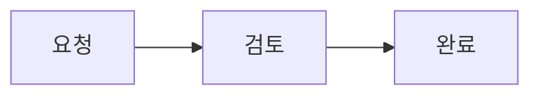
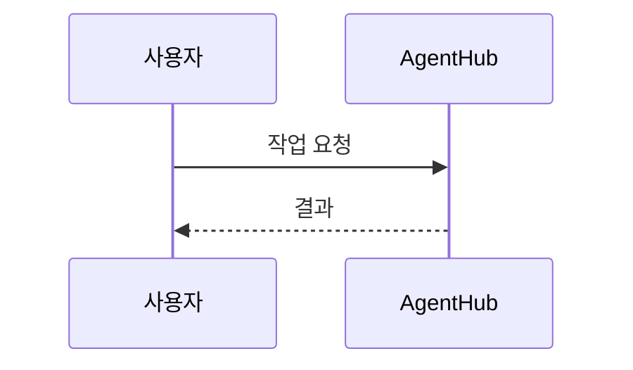

# 채팅에서 Mermaid 다이어그램 보기

AI 답변이나 Markdown 미리보기에 `mermaid` 코드 블록을 쓰면 다이어그램으로 표시한다. 답변을 생성 중일 때는 원문을 보여 주고, 완성된 답변에 닫힌 코드 블록이 있으면 그림으로 바뀐다.

````markdown

````

````markdown

````

- 그림 아래 **Mermaid 원문**을 펼치면 원래 코드를 확인하거나 선택해 복사할 수 있다.
- 넓은 그림은 가로로 스크롤한다. 밝은 배경을 사용해 앱 테마와 관계없이 글자를 읽을 수 있다.
- 문법 오류나 렌더링 실패 시 안내와 원문을 남긴다. 닫히지 않은 코드 블록은 일반 코드로 남는다.
- 렌더러는 앱에 포함되어 인터넷 없이 동작한다. 50,000자를 넘거나 연결이 500개를 넘는 다이어그램은 나눠 작성한다.
- 다이어그램의 HTML·클릭 동작·외부 이미지는 지원하지 않는다. SVG를 정리하고 스타일을 분리해 대화 화면에 영향을 주지 않게 한다.

렌더러: Mermaid 12.2.0, SVG 정리: DOMPurify 3.4.17. 원본 라이선스는 `public/vendor/`에 포함한다.
